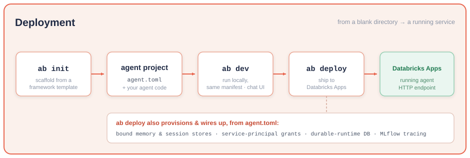

# Agent Bricks CLI (`agentbricks`)

Agent Bricks CLI is an experimental command-line interface for building and deploying custom
agents on Databricks. It manages memory, sessions, tracing, and deployments through one CLI.

> The underlying APIs are in preview and may need workspace enablement.

## Prerequisites

- **Python ≥3.10** to run the CLI; generated agent projects require Python 3.11+.
- **[`uv`](https://docs.astral.sh/uv/)** to scaffold, run, and deploy an agent. Resource
  commands can run without it; reading local traces requires it.
- **[Databricks CLI](https://docs.databricks.com/dev-tools/cli/)** for browser-based
  `agentbricks auth login`. An already-authenticated profile does not require it.

## Installation

The `databricks-agentbricks` Python distribution installs the `agentbricks` command and AgentKit.
Install it from PyPI:

```sh
pip install databricks-agentbricks
```

Install from PyPI rather than from this repository. Templates on `main` can depend on SDK changes that
are not yet released, while generated projects install the released SDK from PyPI, so a CLI installed
from source can scaffold projects that fail to start. To work on Agent Bricks itself, see
[CONTRIBUTING.md](CONTRIBUTING.md).

The base package includes the CLI, store SDK, and `DurableAgentServer` HTTP runtime. Generated projects
declare their framework dependencies automatically.

## Quickstart

Create a new agent project with LangGraph (the default framework). Use `--framework openai`
instead for an **OpenAI Agents SDK** project. This chooses the agent framework, not the model
provider; both templates call a Databricks AI Gateway model.

```sh
agentbricks init my-agent --framework langgraph --profile <profile>
cd my-agent
agentbricks auth login <profile>
agentbricks dev
```

`init` copies a project with a chat UI and records the profile in its local `.env`. `auth login`
authenticates that profile for the CLI. Open the URL printed by `dev` (usually
`http://localhost:8000`) and send a message. Stop `dev` with Ctrl-C, then deploy:

```sh
agentbricks deploy my-agent --source .
agentbricks deployments get agent-bricks-my-agent
```

`deploy` creates or updates the Databricks App and provisions the stores declared in
`agent.toml`. It attempts to grant the App access to them; inspect its output for access or
tracing warnings. `deployments get` prints the App URL and status. Open the deployed chat UI
and send a message to verify it.

### Invoke from the command line

The chat UI is one client of the generated agent. To call its API directly, send a new UUID as
`id` for each turn. Both generated frameworks require a nonempty top-level `session_id` on every
request; reuse it for turns in the same conversation:

```sh
SESSION_ID=$(python3 -c 'import uuid; print(uuid.uuid4())')
INVOCATION_ID=$(python3 -c 'import uuid; print(uuid.uuid4())')
agentbricks endpoint invoke agent-bricks-my-agent \
  --path /api/invocations \
  --json "{\"id\":\"$INVOCATION_ID\",\"session_id\":\"$SESSION_ID\",\"input\":{\"messages\":[{\"role\":\"user\",\"content\":\"Hello\"}]}}"
```

Use `agentbricks endpoint invoke --url http://localhost:8000` instead of the App name to
call `dev` while it is running. Invoking a deployed App requires an OAuth-authenticated
profile; PAT profiles cannot access App routes. See the
[runtime guide](src/databricks_agentkit/runtime/README.md) for streaming, background requests,
and recovery.

## First customization: add a custom tool

Add `agent/tools/count_words.py` to the generated project. Use the version for your chosen
framework:

LangGraph:

```python
from langchain_core.tools import tool


@tool
def count_words(text: str) -> int:
    """Count whitespace-separated words in text."""
    return len(text.split())
```

OpenAI Agents SDK:

```python
from agents import function_tool


@function_tool
def count_words(text: str) -> int:
    """Count whitespace-separated words in text."""
    return len(text.split())
```

Both templates discover decorated tools in `agent/tools/` automatically. Run `agentbricks dev`
again and ask the local chat UI: “Use count_words to count the words in: the quick brown fox.”
The tool returns `4`. Edit `agent/agent.py` to change the model, instructions, or agent logic.
For Databricks-managed tools, see the [Agent tools guide](docs/agent-tools.md).

## Authentication

Deployment reports the user API scopes being added and the tool binding or
`[auth.user].additional_api_scopes` entry that requires each scope. When the required grants already
exist, it reports that scopes are unchanged. Existing grants are preserved when tools change.

Agent Bricks CLI uses [Databricks authentication](https://docs.databricks.com/aws/en/dev-tools/cli/authentication).
Sign in to a profile, then scaffold a project that records it in its `.env`:

```sh
agentbricks auth login <profile>
agentbricks init my-agent --profile <profile>
```

`agentbricks auth login` validates the profile and, in an interactive terminal, runs
`databricks auth login --profile <profile>` if it is not authenticated yet (this needs the Databricks
CLI; in CI or without a terminal, authenticate the profile beforehand). It saves nothing. To change a
project's profile later, run `agentbricks auth switch <profile>` in the project directory, and
`agentbricks auth describe` shows which profile (and workspace) a directory would use.

Inside an Agent Bricks project (a directory with `.agentbricks/project.toml` or `app.yaml`), every
command uses the profile in the project's `.env`. Outside a project, pass the global `--profile/-p`
option before a command, for example `agentbricks --profile <profile> tools list`, or set
`DATABRICKS_CONFIG_PROFILE`. `-p` can go before or after the command —
`agentbricks tools list -p <profile>` works too (the trailing form goes after the full subcommand).
Use `--output json` for scripting.

The profile is resolved in this order, most to least specific: the `--profile/-p` flag, the project
`.env`'s `DATABRICKS_CONFIG_PROFILE` (inside an Agent Bricks project; `dev` and `deploy` resolve
against their source directory so the CLI and the locally running agent use one profile), the
`DATABRICKS_CONFIG_PROFILE` environment variable, and finally the Databricks SDK's default
authentication resolution — which also covers `DATABRICKS_HOST`/`DATABRICKS_TOKEN` environment
authentication, not only `[DEFAULT]` in `~/.databrickscfg`. `dev` passes the resolved profile to
the agent (unless `.env` sets `DATABRICKS_TOKEN` or `DATABRICKS_CLIENT_ID`/
`DATABRICKS_CLIENT_SECRET`). Every command that reaches the workspace prints one stderr line naming
the profile, where it came from, and its host, so the target workspace is never implicit.

Selecting a profile preserves the SDK's precedence for exported credential fields such as
`DATABRICKS_HOST` and `DATABRICKS_TOKEN`; the workspace notice shows the environment host when it
overrides the profile's host. With no selected profile or environment credentials, the default
chosen with `databricks auth switch` takes precedence over `[DEFAULT]`.

`dev` and `deploy` validate authentication before starting work. An external-browser profile's
valid or refreshable Python SDK token cache is reused without opening a browser. If that cache
is missing or unusable, run the suggested `auth login` command in an interactive terminal.

The CLI sends best effort command usage telemetry after leaf commands. Its log records the static
command path, package version, operating system, duration, and process outcome (exit code and, for
nonzero exits, a bounded error category). Parameter entries are limited to options explicitly
supplied on the command line. Free-form options contribute only their static name. Declared Click
choices contribute an `AGENTBRICKS_CLI_`-prefixed value. Click boolean and numeric options
contribute their typed values; non-finite floats and integers outside the log schema's 64-bit
range remain presence-only. Hidden and deprecated options follow the same policy, and repeated
options contribute one parameter entry per supplied value, up to 64 entries. Positional arguments,
raw command arguments, paths, IDs, secrets, arbitrary free-form option values, and exception
messages are omitted. Set
`AGENTBRICKS_DISABLE_TELEMETRY=1` to disable these uploads.

Telemetry runs only when a leaf command is invoked, whether its callback succeeds or fails. Help
and errors rejected during Click parsing, before a leaf starts, do not produce an event. Uploads
reuse the command's workspace client or let the Databricks SDK resolve the selected or default
profile. Authenticate first with `agentbricks auth login <profile>` or configure SDK auth;
an SDK `external-browser` profile may prompt during telemetry even for local commands such as
`init`. The CLI waits up to two seconds for client setup, authentication, and upload on a daemon
thread, returning sooner if the worker finishes. This is not a delivery guarantee: unfinished
uploads can be lost when the process exits after the allowance expires. Missing credentials or a
failed upload never change the command result.

## How it works

`agentbricks init` copies framework and runtime files into your project; you own and can edit
those files. The `databricks-agentbricks` dependency supplies AgentKit and the runtime library.
`agentbricks deploy` uses your source and `agent.toml` declarations to run the agent as a
Databricks App.



## Continue with a specific task

| Task | Guide |
| --- | --- |
| Use a coding agent with the bundled workflow skill | [Coding-agent skills](docs/coding-agent-skills.md) |
| Configure memory, sessions, or the AgentKit SDK | [Memory and sessions](docs/memory-and-sessions.md) |
| Add managed MCP, sandbox, UC function, or Genie tools | [Agent tools](docs/agent-tools.md) |
| Control deployment dependencies and resource lifecycle | [Deployment and lifecycle](docs/deploy-and-maintain.md) |
| Upgrade a customized generated project | [Upgrade a generated project](docs/upgrading-generated-projects.md) |
| Use streaming, background requests, or recovery | [Runtime guide](src/databricks_agentkit/runtime/README.md) |
| Bring an existing agent | [Migration guide](docs/migrating-existing-agents.md) |
| Inspect commands and options | [CLI reference](cli.md) |
| Understand the generated chat UI | [LangGraph](src/databricks_agentbricks/templates/ui/agent-langgraph/CHAT_APP.md) or [OpenAI Agents SDK](src/databricks_agentbricks/templates/ui/agent-openai/CHAT_APP.md) |

## Commands

See [the CLI command reference](cli.md) for all commands, arguments, and options. Built-in
examples are available at each level, such as `agentbricks deploy --help`.

For zsh completion, add this to `~/.zshrc`:

```sh
eval "$(_AGENTBRICKS_COMPLETE=zsh_source agentbricks)"
```

## Contributing

To change the CLI, AgentKit, runtime, or templates in this repository, see
[CONTRIBUTING.md](CONTRIBUTING.md) for local setup, testing, and releases.
