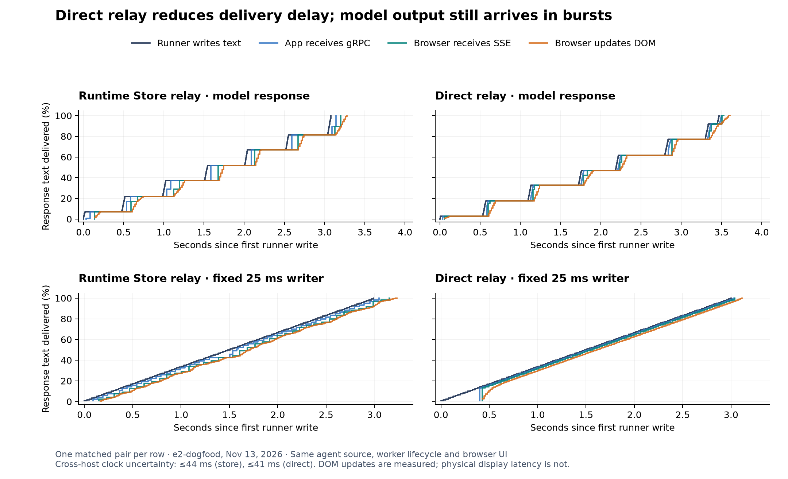

# Sandbox streaming latency investigation — Nov 13, 2026

Direct relay delivers emitted text faster, but did not materially improve time to
first visible text in five matched warm prompt pairs. Roughly half-second pauses
already occur before the runner writes model text. Stream discovery and completion
also have polling delays. Keep the direct transport, and address those separately.

## Measured comparison

| Browser / transport metric | Runtime Store relay | Direct relay |
| --- | ---: | ---: |
| Submit → first visible text | 2.58 s | 2.63 s |
| Runner write → DOM update, approximate | 166 ms | 91 ms |
| App receives gRPC → App yields SSE | 68 ms | 13 ms |
| Browser receives SSE → DOM update | 37 ms | 43 ms |
| Last text DOM update → final status | 163 ms | 223 ms |
| Maximum last text DOM update → final status | 167 ms | 1,155 ms |
| Submit → final status | 5.92 s | 6.14 s |

These are medians across five runs per path; per-chunk metrics use the median of
each run's median. First text excludes session preparation. The median paired
first-text difference was −24 ms, with individual differences from −257 to +164 ms.
This small staging sample supports a delivery-path improvement, not an overall
response-time claim. Every response contained the same 1,784 characters, all 350
text records reached the browser as previews, and each path reused one worker.

Runner-to-browser measurements include clock calibration uncertainty of up to
±44 ms for Store and ±41 ms for direct. App gRPC-to-SSE and browser receive-to-DOM
measurements each use one clock. DOM updates and the next animation frame were
captured in real headless Chromium; physical screen presentation was not measured.

Each plot shows one matched pair, aligned to its own first runner write. Flat
sections in the top row are already present at the producer. The direct fixed-rate
probe also exposes delayed initial attachment followed by prompt delivery.

## Where the remaining delay is

- **Upstream bursts:** The model runs had six or seven pauses over 100 ms at the
  runner write boundary, typically 0.46–0.49 s. That localizes these pauses to the
  model/framework path before JSONL emission. It does not distinguish gateway,
  provider, client-library or LangGraph buffering. The adapter forwards text chunks
  without an intentional batching timer.
- **ExecuteCommand:** Two independent stdout probes wrote 120 records each at
  25 ms intervals. gRPC arrivals were also 25 ms apart, with maximum gaps of 29 and
  39 ms. There is no evidence of a fixed 500 ms transport buffer in this run.
  Synthetic text through the full file/SSE path was similarly smooth once attached.
- **Stream discovery:** Direct `ControlStore.watch` discovers the attempt-file
  descriptor on its one-second state check. In two synthetic pairs this contributed
  to a slower first display: 1.12 → 1.42 s, despite faster subsequent delivery
  (approximately 202 → 130 ms write-to-DOM). A fast producer can write before the
  subscriber attaches. The real model's initial wait largely hid this effect.
- **Completion:** `LivePreview.wait` wakes for text, but the end record does not
  notify that condition. The watcher can wait up to 250 ms before noticing it.
  Its immediate state read can also precede the durable final result, leaving
  another one-second poll. We observed one 1.15 s gap after the final DOM update.
  The usual visible gap also grows because text arrives earlier: last runner
  write → final status was 374 → 343 ms at the median. Durable commit timestamps
  were not captured, so the exact cause of the outlier is not proven.
- **Browser:** Existing smoothing added roughly 37–43 ms per model chunk. It
  accounts for some latency, but cannot explain pauses already present at emission.

Next, notify subscribers when a stream descriptor is published and when the final
result is durably committed, retaining periodic checks for recovery. A sandbox end
record must not by itself mark the invocation successful. Separately, compare raw
gateway SSE arrival with LangGraph chunk emission for the same model to locate
upstream batching. Neither follow-up was deployed during this measurement.

## Capture and reproduction

The isolated App `agent-bricks-sb-stream-1113` ran one instance in e2-dogfood. Its
diagnostic wheel was `0.10.0.dev0+sandbox.0ed8dbe7cf559e0a`, deployment
`01f1df2bcb231c47afd3950b0abc954e`. It used the main workbench's unchanged LangGraph
source hash `a9c7bf92ca2ff52275a6f3272bf06bf87dd5d2e65411e247df3a131064d7b093`,
agent SDK wheel `0.10.0.dev0+sandbox.b4733b5d99718212`, tracing, tools and SQLite
session history. The model was `system.ai.gpt-5-mini`; no tools were invoked.

Both paths shared current code at `fbe69c0f`, including runner, source install,
worker, UI and instrumentation. The Store arm substituted `RunManager._invoke`
and `ControlStore.watch` from `afc6427a`, retaining its 50 ms SQL publish/poll path.
This compares the old and new streaming implementations, including follower
attachment timing; it does not isolate only the cost of a database write.

The capture procedure was:

1. Prepare two dedicated sessions, then make one model warmup request on each.
   Keep one resident worker per path and alternate execution order between pairs.
2. Run two fixed-rate pairs: the runner writes 120 chunks, one every 25 ms, using
   the regular file/transport/browser path. This probe skips the framework only.
3. Run five model pairs with the same prompt and matched conversation history:
   `Copy the following 35 lines exactly, without any introduction, explanation or
   code fence. Do not use any tools.` Follow with lines `01.` through `35.`, each
   containing `The forest changes gently through the seasons.`
4. Timestamp each JSONL write immediately before append/flush; each gRPC stdout
   receipt before decoding; each App SSE yield; each browser EventSource receipt;
   each DOM text update and its next animation frame. Match cumulative Unicode
   character counts across these boundaries. Read the completed producer file to
   verify that missing trailing records cannot bias the result.
5. Bound host-clock offsets using request/response samples before and after the
   run. Capture direct stdout probes independently of files and `tail`.
6. Stop both test sandboxes and confirm their state, then stop the diagnostic App.

[Per-run results, coverage, identity and capture hashes](evidence/streaming-latency-2026-11-13.json)
are included with this report. Raw timestamp captures and the instrumented-build,
browser, analysis and plotting scripts remain in the local worktree at
`.agentbricks-playground/.state/stream-latency-1113/`; the remote diagnostic endpoints
are not shipped in the prototype package. The figure has
[editable SVG](diagrams/sandbox-streaming-cadence.svg).

All 16 invocations succeeded. Both test sandboxes and diagnostic App were confirmed
stopped. The main `sb-workbench-1109` App remains active at deployment
`01f1df29996b1c868c474280ddfb5d63`. This investigation changed no runtime code,
source installation or Runtime Store schema.
