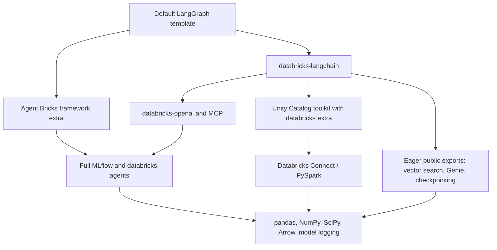

# Why the sandbox worker is slow to initialize

Investigation: 2026-11-13, e2-dogfood, Python 3.12.3. Baseline: the LangGraph agent used in the recorded demo, source SHA-256 `666424f2b35435a4063d0fea1df3f087889002d99bc74186e416ccaa0aef2245`.

**The default chat worker imports substantially more than chat requires.** A leaner dependency experiment reduced its first initialization from **13.3 s to 9.2 s**, with peak RSS falling from **353 MiB to 204 MiB**. The real agent still streamed, called its sample tool, preserved managed conversation history, and exported model/tool traces. This establishes a useful packaging direction, not a production-ready distribution or a latency SLA.

## What the time actually measures

The benchmark measures adapter import plus the real `prepare_session` hook *inside* the agent interpreter. It excludes sandbox allocation, source copy, dependency installation, interpreter startup, App/store coordination, and LLM inference. It uses newly installed environments, not warm-pool hits. Each initial variant has **one cold sample** on a separate dedicated sandbox; differences below about a second should not be treated as established improvements.

The demo recording reported 14.4 s for handler preparation, including its launch/transport path, versus 12.1 s attributed to framework imports. Here, direct initialization reproduced 13–14 s. The user's observed 18+ s remains a broader UI observation; this investigation does not attribute the difference without a correlated App run.

An additional cold import profile separated the major costs:

| Work, in execution order | Time |
| --- | ---: |
| Adapter import | 0.06 s |
| LangChain messages and SQLite checkpoint support | 0.78 s |
| AgentKit session adapter, including Databricks SDK | 2.75 s |
| MLflow import | 4.64 s |
| Project import, including chat/integration/framework code | 3.82 s |
| Experiment/auth/tracing configuration | 0.73 s |

These are sequential attribution measurements; importing a package earlier changes which phase receives its cost. Python import profiling has overhead and is separate from the unprofiled comparisons below.

## Where unnecessary work enters

- The SDK base says `mlflow-skinny`, but both framework extras and the released LangChain/OpenAI/MCP integrations bring full `mlflow` back. Installing Skinny alongside full MLflow does not make its import path lightweight.
- The Unity Catalog toolkit's `databricks` extra installs Databricks Connect. MLflow experiment setup checks for an active Spark session and imports the installed PySpark stack even though this agent never runs Spark. In the tracing-only experiment, this shifted about 2.5 s into the **bindings** step until Connect was removed.
- Even `mlflow-tracing` loads an Arrow artifact backend when Arrow is installed. Removing unused Arrow eliminated NumPy/Arrow from this agent's import set too.
- Importing `ChatDatabricks` through the released package initializer also imports unrelated integrations. Earlier lazy-export changes exist in the original local checkout, but **the demo's installed integration wheels do not contain them**. Packaging the Agent Bricks wheel alone does not ship changes to these separate distributions.
- `databricks-agentbricks` also installs the CLI, HTTP runtime, SQLAlchemy/Postgres helpers, and framework adapters together. The sandbox worker calls a Python handler; it does not run that HTTP server. The managed Session Store path uses REST rather than a Postgres connection.

## Experiments

Same agent source, dependency versions, tracing destination, and preparation hook. Import-only edits were applied to the installed versions, avoiding a comparison that also upgrades frameworks.

| Variant | First initialization | Peak RSS | Loaded modules |
| --- | ---: | ---: | ---: |
| Baseline | 13.30 s | 352.8 MiB | 4,027 |
| Lazy integration exports and deferred numerical/model-resource imports | 13.95 s | 340.6 MiB | 3,872 |
| Above + tracing-only MLflow | 12.14 s | 316.3 MiB | 3,356 |
| Above + omit unused Databricks Connect | 9.53 s | 244.6 MiB | 2,822 |
| Above + omit unused Arrow | 9.19 s | 204.0 MiB | 2,723 |

**Lazy imports alone were insufficient.** Tracing still imported much of the same heavy graph. The successful direction combines import boundaries with dependency boundaries.

The tracing variants use `uv sync --no-install-package` solely to test feasibility. They intentionally do **not** satisfy every declared requirement of the current broad packages. They must not be deployed as a lockfile workaround: shipping this requires supported runtime dependencies and optional feature extras. Full/skinny/tracing MLflow distributions share the `mlflow` namespace; the worker's final resolved environment must be verified, not just its top-level requirements.

Two real invocations on each of the last two variants verified `get_current_time`, streamed text, managed Session Store persistence across turns, and successful persisted MLflow root/model/tool spans. The follow-up returned the codeword from the preceding turn. On the smallest variant, per-invocation preparation was 85 ms and 7 ms after initialization; this shows the removed work did not simply reappear in the first invocation's preparation. These smoke tests ran under the sandbox creator identity, not the App service principal. OpenAI received import-boundary/unit coverage, not a separate live cold-start benchmark.

## What remains, and what to productionize

1. **Define a supported worker dependency set.** Separate AgentKit execution/adapters from CLI, deployment, HTTP server, local database, model logging/evaluation, and direct Spark/UC execution dependencies. Keep the existing full installation available; make advanced features explicit extras or separate distributions. A sandbox deployment should select the worker set without deleting arbitrary user dependencies.
2. **Use tracing-only MLflow for workers that only trace.** The tested 3.18.0 tracing package supports the template's autologging and trace APIs. Keep Skinny/full MLflow where tracking/model-management functionality actually requires it. Make Connect and Arrow opt-in for agents that use those features. Dependency declarations across the bridge/integration packages must agree; editing the template alone is insufficient.
3. **Ship the lazy-export fixes across all affected integration wheels.** Preserve public imports and load their implementation when used. These are useful boundaries and prerequisites, even though this benchmark did not establish a standalone cold-start win.
4. **Address the Databricks SDK import upstream.** Its generated initializer eagerly imports service modules for jobs, catalog, compute, SQL, and many other APIs. It contributed about 2.7 s cold and 1.3 s with bytecode present. Importing a narrower SDK submodule still executes the package initializer. A supported lazy client/service implementation belongs in the SDK generator; bypassing SDK authentication is not the solution.
5. **Retain bytecode and resident workers; measure total readiness.** In a separate `cProfile` run after removing only this experiment's venv bytecode, compilation of 3,518 modules cost 7.46 s out of 15.70 s profiled execution. Class/model construction also costs time (2,655 dataclasses and 1,423 Pydantic models were processed). A fresh process on the already-imported baseline disk took about 5.4 s; the smallest variant took 4.4 s. These are *new processes with cached bytecode*, not reused resident workers. Precompiling during first-invocation installation moves work earlier and may not reduce installation-plus-readiness time. Building it into a target-matched artifact or prepared warm spare amortizes that work; bytecode alone does not preserve initialized classes or clients.

The current read-ahead helper also spends roughly 0.5–0.7 s scanning/recording imports and can read native extensions the chat agent never uses. It is secondary to package boundaries; no change to its default was made from these samples.

## Local changes and reproducibility

Candidate branch: `codex/agentbricks-worker-startup-1113`, based on `827dda3c`. The user checkout and demo deployment were left unchanged. Local changes restore lazy exports in LangChain/OpenAI/MCP, isolate numerical utilities, defer MCP model-resource imports, and split both sandbox adapters' startup timings into framework, AgentKit, tracing, and project imports. Broad dependency declarations are deliberately unchanged until the package contract is designed.

[Measured evidence and inspected traces](evidence/sandbox-worker-startup-1113.json). Reproduction scripts remain at `/home/james.wu/agentbricks-demo/worker-startup-20261113/`. `build-and-method.json` records exact source hashes and limitations; per-variant directories contain timing JSON, import profiles, and live verification. `investigate.py`, `patch_imports.py`, and `verify_agent.py` reproduce the experiments. `cleanup.json` confirms all six dedicated sandboxes stopped. The benchmark changed no live App configuration.

Validation: 15 integration import/utility tests passed; 34 sandbox adapter/worker tests passed, with one framework-dependent test skipped. Chat/MCP-client/vector-store regression tests completed 199 passes and two skips before the separate MCP suite entered an SDK retry against its synthetic host; that interrupted run is not a full-suite pass. Lint and whitespace checks passed. Live minimal-runtime traces include `tr-437b20053775e797ead3776f4b44e412` (tool turn) and `tr-a1082e943685c2f2dd9dea1bcad02060` (history turn), with successful persisted spans inspected.
