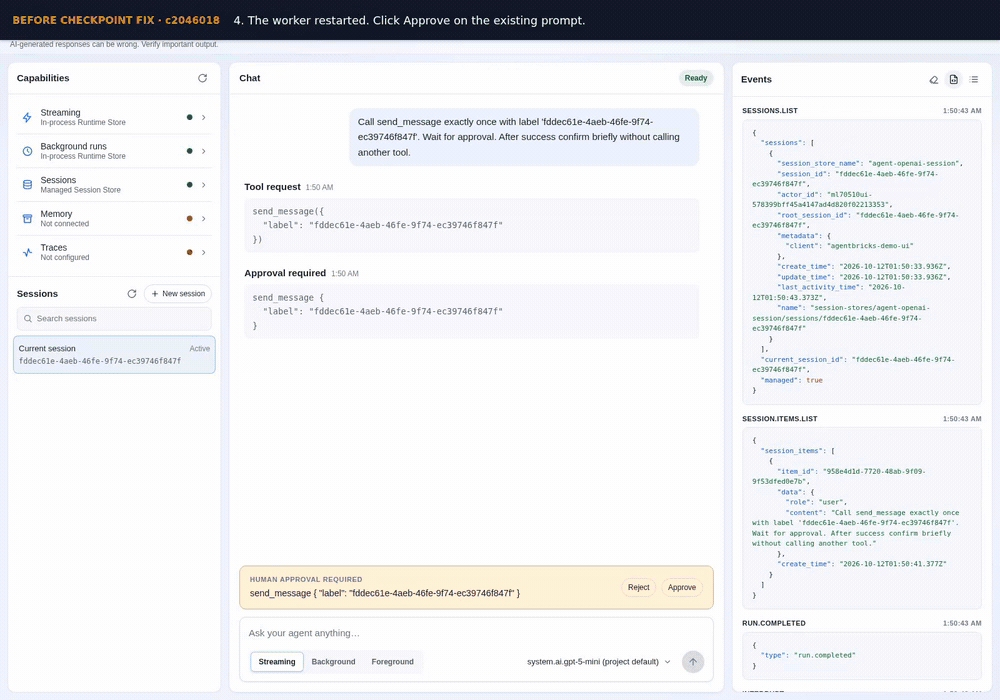

# PR #704: recorded before/after validation

[Download the full 2:09 MP4](before-after.mp4) (H.264, 1600 × 1120, 25 fps, 5.3 MB).

| Start in full recording | Clip | What it demonstrates |
| --- | --- | --- |
| 0:00 | [Before checkpoint fix](before-checkpoint-fix.mp4), 38 seconds | Original example templates from `c2046018`: pause, restart worker, then approve. The invocation fails; the server reports `No paused run for this session`. Tool execution count remains zero. |
| 0:38 | [Before UI guard](before-ui-guard.mp4), 36 seconds | UI from `4f6e3c41` with the current backend: a normal follow-up during pending approval sends another invocation and loses the approval controls. |
| 1:14 | [After the fix](after-002a8592.mp4), 55 seconds | Current PR head `002a8592`: restart the worker; an ordinary follow-up is blocked while draft and approval controls remain. Approval resumes the saved run and the tool executes once. |

## Short preview

This 37-second animated preview contains moving excerpts from the three recordings; the full MP4 above contains each scenario in full at its original playback speed.

## Test setup and verification

Recorded with real Chromium, `system.ai.gpt-5-mini`, and managed Session Store using the explicit `ml-inference-staging` profile. Local HTTP workers run the actual example UI/runtime. The approval-gated test tool writes a local marker; no external message is sent. The shared SDK runtime is the current checkout in all three cases; the before clips use the template/UI revisions stated above.

The caption bar is test annotation. Labels about worker restart, tool count, checkpoint preservation, and the original server error are backed by process, request, Session Store, and worker-log assertions. No UI outcome is fabricated.

All 26 assertions in the three selected runs passed. All five sessions from those runs were deleted; the one session from a superseded recording was also deleted. Shared store metadata was unchanged. Source hashes, capture steps, media hashes, and verification details are in [validation.json](validation.json).

The browser page stays open across worker restart. These recordings do not claim deployed-App validation, browser-reload discovery, or distributed failover.

These assets live on the separate `codex/pr-704-test-videos` evidence branch and do not add files to the code PR. Raw WebM recordings, Playwright traces, and detailed logs remain in the local test evidence directory.
